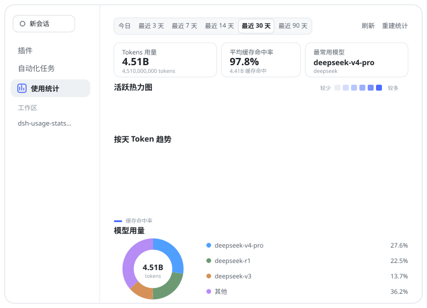
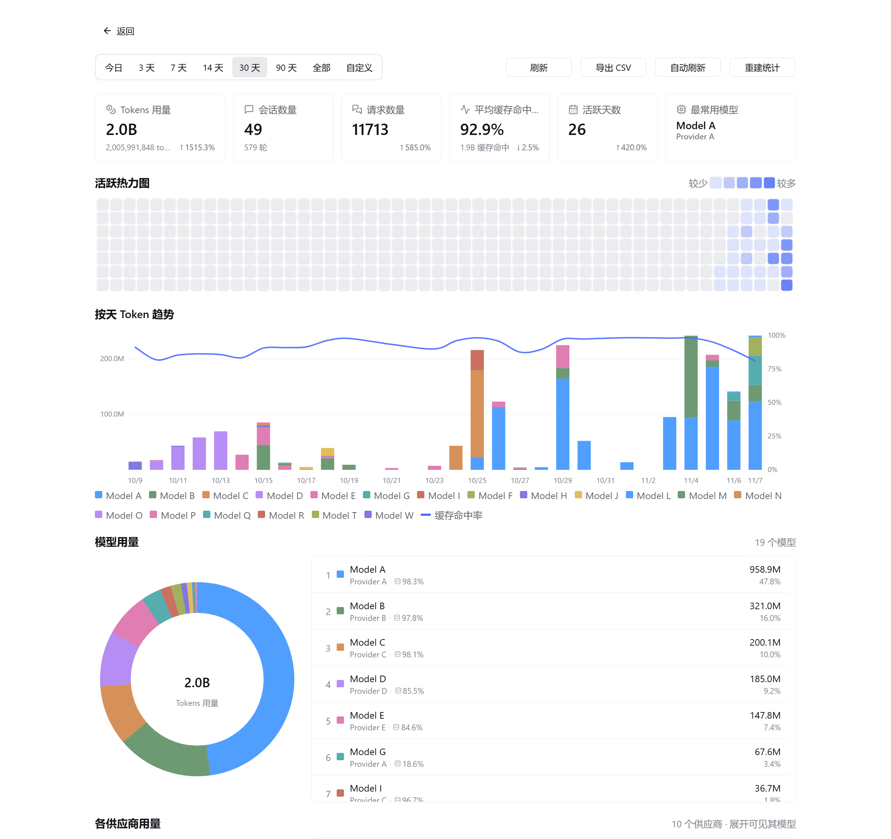
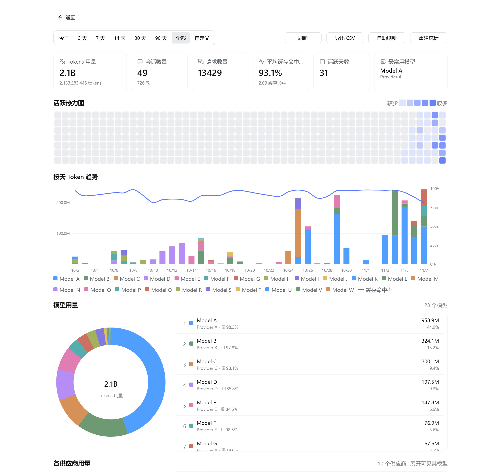
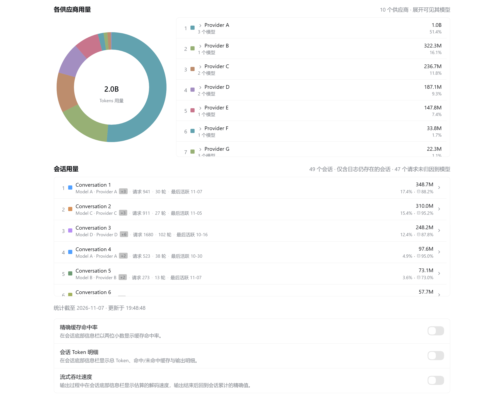

# dsh-usage-panel-plus

[English](README_EN.md) | 中文

<p align="center">
  <picture>
    <source media="(prefers-color-scheme: dark)" srcset="docs/banner-zh-dark.svg">
    
  </picture>
</p>

> **一个独立安装、独立运行的 DSH 用量统计插件。**
> 它从 [`HaoyueQin/dsh-usage-statistics-panel`](https://github.com/HaoyueQin/dsh-usage-statistics-panel)
> v0.3.4 分叉而来，感谢原作者以 MIT 许可发布；原版权声明完整保留在
> [LICENSE](LICENSE) 与 [NOTICE.md](NOTICE.md)。本插件**不是**上游官方发布，
> 与上游无隶属关系、未获背书，也不作为上游的升级版发布。
>
> 与上游的关键区别见下；本项目有自己的包名、版本号、bundle id、路由前缀、
> 存储域与面板 id，因此**可以与上游同时安装、互不干扰**。


### 独立身份

| | 本插件 | 上游 0.3.4 |
|---|---|---|
| 包名 / 版本 | `dsh-usage-panel-plus@0.1.1` | `dsh-usage-statistics-panel@0.3.4` |
| bundle id | `dsh-external/dsh-usage-panel-plus` | `dsh-external/dsh-usage-statistics-panel` |
| 路由前缀 | `/usage-panel-plus/api` | `/usage/api` |
| 存储域 | `usage_panel_plus` | `usage_history` |
| 面板 id | `usage-panel-plus` | `usage-stats` |

因此安装本插件**不会**接管或覆盖上游面板的数据；首次启用时它会从本机会话日志
重新回扫，构建一份独立的历史（日志已被删除的会话无法归因，属已知边界）。

### 功能亮点

- **真实会话维度**：`sessions` / `session_meta` 两张表与独立回扫游标，汇总卡显示真实会话数，
  并新增「会话用量」区块（按会话展开模型明细、每会话缓存命中率、无法归因请求数如实披露）。
- **时间范围新增「全部」**：起点取 store 里最早的一天，而非固定回溯天数。
- **取消「其他」聚合**：模型与供应商全部独立成行与独立环图扇区，色板超出后循环复用。
- **每行缓存命中率**：模型行与会话行都以「图标 + 百分比」显示自身命中率。
- **CSV 导出 / 自动刷新 / 环比徽标 / 惰性挂载 / 20s TTL 缓存**。
- **客户端 bundle 750 KB → 约 207 KB**（ESM 入口让图标 tree-shake 生效）。

完整差异清单见 [docs/ENHANCEMENTS.md](docs/ENHANCEMENTS.md)；质量验收报告见 [docs/QA.md](docs/QA.md)
（PASS，含 2 个已知待办与 3 条设计边界）。

### 构建与测试

需要 **Node ≥ 22**（`tsdown` 依赖 `Promise.withResolvers`）。

```bash
pnpm install --frozen-lockfile
pnpm typecheck     # tsc --noEmit，0 error（strict + noUncheckedIndexedAccess）
pnpm test          # 构建 + 444 tests / 38 files
```

### 安装到本机 DSH

作为独立插件安装（包名 `dsh-usage-panel-plus@0.1.1`，与上游 `dsh-usage-statistics-panel` 不冲突）：

```sh
dsh plugin --profile <name> add dsh-usage-panel-plus@0.1.1
```

或从本仓库源码构建后，把产物（`lib/index.js` 宿主半、`lib/client.js` 与
`lib/client-registry.js` 客户端半）放进 DSH profile 下的
`node_modules\dsh-usage-panel-plus` 目录：**宿主半改动需重启 DSH**，客户端半刷新页面即可。

因为包名与版本都独立，市场不会把它当作上游的「升级」，装任一方都不会覆盖另一方。

**从旧版迁移**：若同一台机器上装过上游的 `dsh-usage-statistics-panel`，本插件首次启动会自动把旧
`usage_history` 域的逐日 / 逐小时记录与回扫游标并入自己的 `usage_panel_plus` 域（一次写入
`legacyImported` 标记后不再重复），所以历史用量不会因为换域而丢失；旧文件保持原样不被修改。

DSH web 插件的用量统计面板：按天 / 按小时的 Token 趋势、GitHub 风格活跃热力图、缓存命中率曲线、按模型与按供应商两种用量拆分（环形占比图 + 明细列表），作为**插件**页中本插件的独立页面，并在左侧栏提供独立入口。

所有图表均为手绘 SVG，不依赖图表库；配色是固定的 rank 色板（`--dsw-chart-1..10` 给模型、`--dsw-provider-1..5` 给供应商，超出后循环复用——本增强版没有灰色 "Other" 桶），暗色主题下整体提亮，随 DSH 主题自适应。

<p align="center">
  
</p>

## 预览

<p align="center">
  
</p>

<p align="center">
  
</p>

<p align="center">
  
</p>

> 以上截图取自真实运行的 DSH 面板，但**所有标识符已脱敏**：模型、供应商、会话标题一律替换为中性标签（Model A / Provider A / Conversation 1），账号与订阅信息不出现。图表比例与数值是真实用量。

## 功能

- **时间范围**：今日、最近 3 / 7 / 14 / 30 / 90 天、**全部**，或自定义起止日期；今日与最近 3 天按小时汇总，其余按天。「全部」的起点取 store 里最早的一天（不是固定回溯天数），空库时塌缩到今天
- **汇总卡片**：Token 用量（K/M/B 紧凑主值，下方带精确值）、会话数量（**真实会话数**，副标题为完成轮次）、请求数量、活跃天数、平均缓存命中率（附缓存命中绝对量）、最常用模型；每张卡带上一时段环比徽标（无对比窗口时不显示徽标，不写"新增"）
- **52 周活跃热力图**：每日 token 用量的 GitHub 风格色阶，悬停查看当天明细；数据窗口固定为一年，列数随可用宽度自适应（窄窗口显示较少周数），图表始终左右撑满
- **Token 趋势**：堆叠柱状图叠加平滑的缓存命中率曲线（Catmull-Rom 样条），今日 / 最近 3 天按小时分桶、其余按天，悬停查看各模型拆分；宽度随容器自适应，始终左右撑满
- **模型用量**：环形占比图 + 明细列表，**每个模型都独立成行与独立扇区**（没有 "Other" 聚合桶，色板超出后循环复用）；每行显示该模型自己的 token、占比与缓存命中率；圆环直径随可用宽度在 200–280px 间自适应，并与右侧清单垂直居中；列表在固定高度内滚动
- **供应商用量**：同一结构上移一层——**每个供应商都独立成行**（独立色板，同样没有 "Other"）；悬停任一侧联动另一侧，圆环悬停显示该供应商的全部模型用量；每行可展开该供应商的模型明细
- **会话用量**：按 token 排序的会话列表，每行给出标题（无标题时用短会话 id）、主模型、token 与占比、缓存命中率、请求数、轮次与最后活跃日期；点开可看该会话内部的模型拆分；超出可视高度在框内滚动，无法归因到模型的请求数如实披露
- **导出与刷新**：工具栏可一键导出当前范围为 CSV（summary / day / model / provider / session 五种行，UTF-8 BOM + CRLF），或开启 60 秒自动刷新（页面隐藏时自动暂停）

- **底部信息栏增强**：面板底部可开启"精确缓存命中率"（会话底部信息栏的缓存命中率以两位小数显示，如 85.25%）、"会话 Token 明细"（底部信息栏显示总 Token、输入、输入（命中缓存）、输入（未命中缓存）与输出 Token，替代默认的"输入/输出"两项）与"流式吞吐速度"（输出过程中速度读数随每个增量实时刷新为估算值，某一步结束后回到会话累计的精确值；估算以 DeepSeek 公布的字符密度为先验，再用本会话已结算步骤的实测字符/Token 比率校准，读数取最近 2 秒内实际观测到的 Token 增量并做平滑（单帧抖动不会传导到显示），UI 迟发的积压不会被计入，一步中途静默时保持最后一次读数而不是回落到会话平均值）；开关位于"使用统计"面板底部，三个开关同款样式，切换即时生效
- **历史回扫**：首次启用时枚举并回放既有会话日志；对挂载后才首次观测到的活跃会话，其挂载前的历史会在下一次启动时按事件序号边界回放补全，从安装日起尽量还原历史用量
- **本地持久化**：数据写入 `$DSH_HOME/storages/usage_panel_plus.json`（storage-domain），纯本地、无外部依赖

## 安装

作为独立插件安装（包名 `dsh-usage-panel-plus`，与上游 `dsh-usage-statistics-panel` 不冲突）：

```sh
dsh plugin --profile <name> add dsh-usage-panel-plus@0.1.1
```

装完**硬刷新浏览器**（Cmd/Ctrl+Shift+R）：client 半的改动 DSH 会热加载，无需重启；仅 host 半（采集/存储/路由）更新时需要重启 DSH。由于包名与版本都独立，市场不会把它当作上游的「升级」，装任一方都不会覆盖另一方。

插件挂载后有两个入口：左侧栏 **新会话** 下方的 **用量面板** 行，或在 **插件** 页里进入 **已安装** → `dsh-usage-panel-plus` 的详情页（卡片与详情页的标题、描述、图标取自本包的 `locale/*.json` 与 `icon.svg`，随界面语言在简体 / 繁体 / 英文之间切换）。两处渲染的是同一个面板；**独立面板左上角有返回按钮**，点击即回到进入它之前的界面（会话、插件页或其它面板）。

**兼容性**：本插件的 `0.1.0` 是独立首发版本，支持 DeepSeek Harness `>= 0.1.7-rc.1`；本包没有更老的版本可选，上游历史版本号不适用于本包。

`/usage-panel-plus/api` 的信任围栏也按宿主代际取源：`0.2.1-alpha.2` 起官方把显式授权移到 `webStartup`、删除 `webRuntime`，并新增「接受监听端自身 bind 地址」；此前 `webRuntime.trustedHosts`（含绑定时采样的局域网地址）才是官方围栏接入的那一份。插件按 `webRuntime` → `webStartup` 的顺序读，并始终把 `webServer.host` 当作可接受的 bind 字面量（未指定地址拼写除外），两代都与官方同语义放行/拒绝。

> **已知差异**：官方那两个统计条目会跟随「性能与用量显示」偏好（紧凑档只留速度 / 只留缓存命中），本插件的遮蔽条目不跟随，始终渲染详细读数。该偏好的数据源在 ui-chat 私有的 config form 里，跨插件直读属于易碎耦合，故这里选择不实现——两代宿主上行为一致，并非 `0.2.1-alpha.2` 引入的差异。

底部信息栏那一行按宿主容器自适应：`0.1.6-alpha.2` 起宿主把它放进与上下文占用环并排的 flex 行里（居中、间距、顶距与侧边距都由该容器负责），`0.1.6-alpha.1` 及以前它仍自持内容宽度、左右侧边距与 4px 顶距——同一份构建在两种宿主上都对齐。

> peer 依赖中的 `@deepseek-ai/*` 只表达能力下界（`>=0.1.7-rc.1` 是插件用到的最早接口面），并全部标记为 optional。按 semver 的预发布规则，该范围只匹配同一 tuple 的预发布版——`0.1.7-rc.2` 判为满足，而下一个预发布行（`0.1.8-rc.1`）仍判不满足——所以实际支持的宿主版本以本段说明为准，不依赖 npm 的 peer 校验。

> **旧宿主用户**：`0.1.6-alpha.2` 及更早的 DeepSeek Harness 请安装本插件 `0.3.0` 及之前的版本。宿主在 `0.1.7` 线把 `@deepseek-ai/dsh-client-ui-primitives` 的图标导出整体改为字重命名（`*Outline16` → `*OutlineRegular` / `*Medium`），两代导出名**无交集**：旧名在 `0.1.7+` 上解析为 `undefined`，会让底部信息栏渲染失败——一份构建无法同时服务两代。

## 数据来源

面板的数据采集是**观测式**的，共三处来源：会话事件流（`session/event`）中的 `assistant/message` 与 `assistant/chunk`（agent loop 的每次调用）、同一事件流中的 `compaction/summary`（会话压缩的摘要调用——它的用量只记在该事件里，因为摘要并不产生 `assistant/message`），以及 `llm/stream` 瀑布事件（AI 生成的会话标题——标题调用在会话日志里只留下请求、不留用量）。三处都提取 provider 上报的 token 用量（输入 / 输出 / 缓存读 / 缓存写）。去重与归因各不相同：agent loop 的调用在**单个会话内**按 `(turn, step)` 去重（同一调用只计一次、保留先到的样本——两个官方适配器对流式采样与最终上报的数值完全一致；并发会话各自独立计数、互不吞样本），模型归因优先取消息自带的 `source`（每次调用各自标注），缺失时回退到会话的路由折叠（`request/context` 事件或会话的 `requestContext()`），宿主重启后也不会落入 "(unknown)" 桶；压缩按 `compactionId` 去重，并以事件自带的 `provider`/`model` 归因；标题每次调用计一次（token 加一次请求），取该次流中**最后一个** usage 样本——适配器上报的是累积值，累加会重复计数。首次启用时还会回扫既有会话日志补齐历史。

> 提示：Token 用量从插件启用（含回扫）之日起累计；更早的会话日志若无 provider 上报的用量数据，则无法回溯。**会话标题是唯一例外**：它的用量不在会话日志里，只能由插件运行时从 `llm/stream` 截获，因此既无法回扫补齐，插件未运行期间发生的标题调用也会漏计。

**子代理会话**：子代理是独立会话，其 token、请求与完成的轮次与顶层会话一并统计（实时采集覆盖全部会话事件流，重启后回扫同样覆盖子代理会话日志）；父会话仅收到子代理结果摘要，不会重复计入。子代理会话早期的请求标记（step/start）先于其路由事件写入日志，首个请求可能统计在 "(unknown)" 桶——请求总数不受影响。

**Token 口径**：汇总卡片与趋势图的 Token 总量为**服务商总口径**——未缓存输入 + 输出 + 缓存读 + 缓存写（DeepSeek 会把 prompt 拆成输入/缓存读两个不相交的桶，简单相加会漏掉占大头的缓存部分）。它的**统计范围**是 agent loop 的会话调用、会话压缩与 AI 生成的会话标题，**不含联网搜索**：DSH 的搜索后端用 provider 私有的 HTTP 客户端直连搜索端点，既不在会话日志留下用量、也不经过 `llm/stream`，插件侧无从获取，因此本总量与服务商账单面板之间最多相差这一项。平均缓存命中率以输入侧（命中 + 未命中）为分母，其中**未命中 = 未缓存输入 + 缓存写入**——与会话底部信息栏（官方 StatsLine 口径）完全一致，两处读数不会出现分歧；命中率卡片下方同时展示缓存命中的绝对 token 量。

**压缩口径**：一次压缩计一次请求——后端内部的重试不可见（压缩调用不经 `llm-retry`）；压缩失败时不会写入 `compaction/summary`，这次调用也就不计，尽管它可能已被计费。**会话标题**同样每次调用计一次请求与一次 token（取流中最后一个 usage 样本），流被超时或取消打断时仍记账。

**重建统计**：面板工具栏（**刷新** 右侧）的 **重建统计** 按钮就是这个动作，需二次确认——首次点击变红显示「确认重建？」，再次点击才执行（移开焦点、按 Esc 或 5 秒内不再点击都会自动取消）。它等价于 `POST /usage-panel-plus/api/reset`（与面板同源信任围栏保护）：清空本地统计并按当前归因规则全量重放会话日志——用于历史数据损坏或归因规则升级后的重建。仍在进行中的会话以其重置时刻的日志长度为界：界内由重放重建、界外继续由实时采集，恰好各计一次。

## 开发

```sh
pnpm install
pnpm typecheck   # tsc --noEmit
pnpm test        # vitest
pnpm build       # tsc declarations + tsdown (host ESM + 双通道 client bundle)
```

## 设计与实现

- **Host 半**（`src/`）：`collector`（事件订阅 + 回扫折叠）、`store`（`usage_panel_plus` storage-domain）、`query`（范围聚合，翻译自 reasonix 的 query.go）、`routes`（`/usage-panel-plus/api` fenced JSON 路由，信任围栏与 `/api` 网关一致）
- **Client 半**（`src/client/`）：`UsageStatsPanel.tsx`（手绘 SVG 图表，移植自 reasonix 面板 + rank 色板）、`locales`（en / zh / zh-TW）、`api`（`/usage-panel-plus/api` fetch 封装）
- **双通道打包**：`lib/client.js`（官方 profile 通道，bundle id = 包名）与 `lib/client-registry.js`（插件注册表通道，bundle id = manifest id）。harness 0.1.x 官方加载链只消费前者；后者为外部 registry 通道预留，当前无消费者
- 详细设计见 [docs/design.md](docs/design.md)

## 致谢

本面板是对 reasonix 用量统计功能的复刻移植：作者曾为 [DeepSeek-Reasonix](https://github.com/esengine/DeepSeek-Reasonix) 实现并贡献了该功能（PR [#7238](https://github.com/esengine/DeepSeek-Reasonix/pull/7238)、[#7503](https://github.com/esengine/DeepSeek-Reasonix/pull/7503)），本插件按 DSH 的插件规范将其移植到 DeepSeek Harness，前端图表大比例复用原实现，数据层则基于 DSH 的会话日志与 storage-domain 重新实现。

## License

MIT
