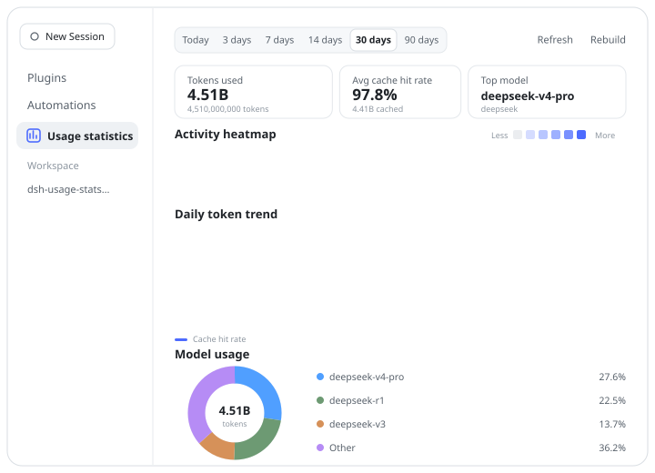
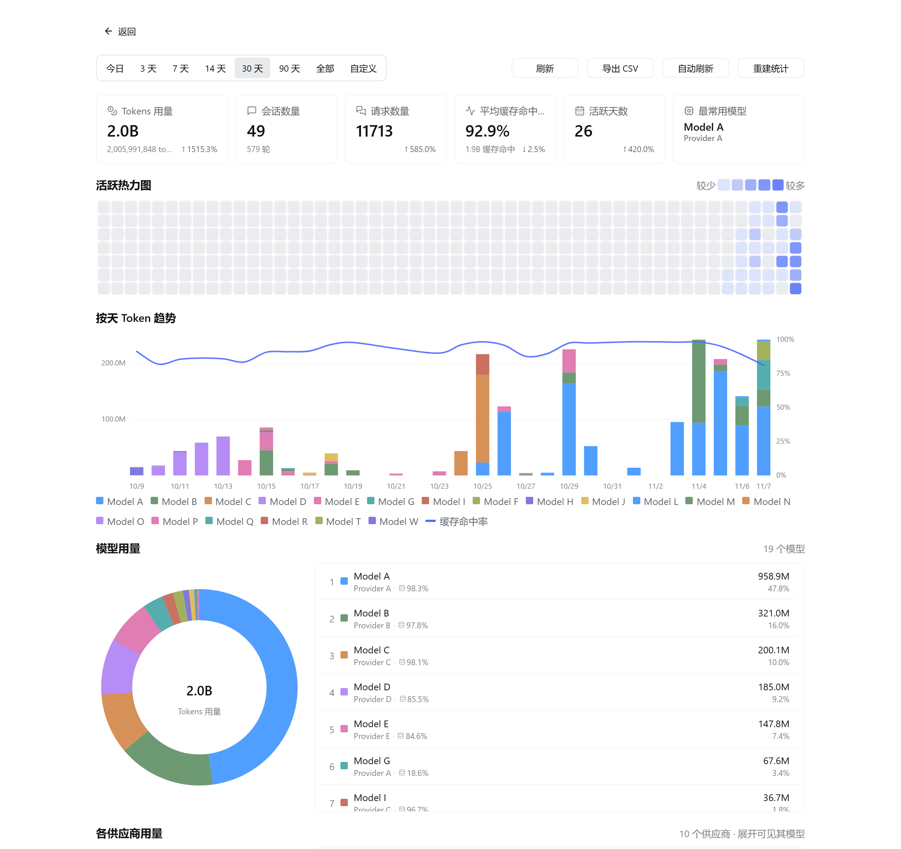
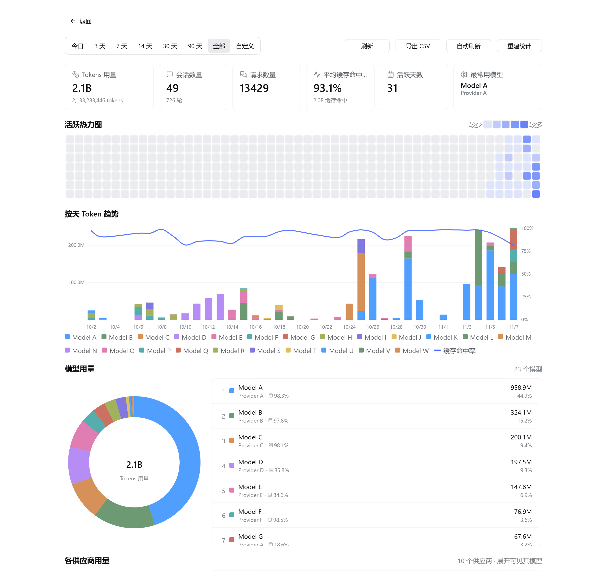
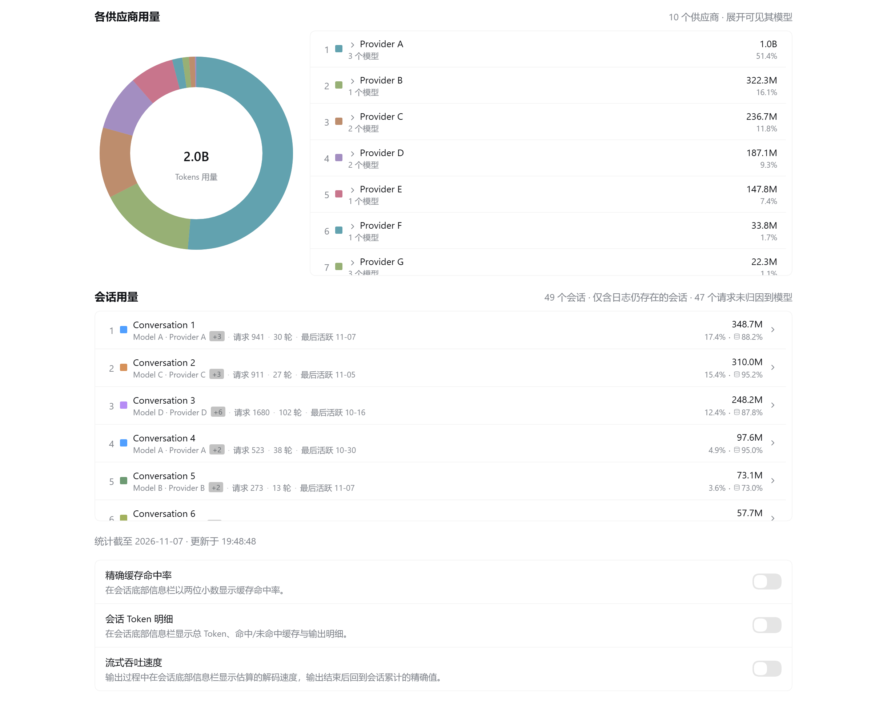

# dsh-usage-panel-plus

English | [中文](README.md)

<p align="center">
  <picture>
    <source media="(prefers-color-scheme: dark)" srcset="docs/banner-dark.svg">
    
  </picture>
</p>

> **A standalone, separately installable DSH usage statistics plugin.**
> It was forked from [`HaoyueQin/dsh-usage-statistics-panel`](https://github.com/HaoyueQin/dsh-usage-statistics-panel)
> v0.3.4, released under MIT by its author; the original copyright notice is
> preserved in [LICENSE](LICENSE) and [NOTICE.md](NOTICE.md). This plugin is
> **not** an upstream release, is not affiliated with or endorsed by the
> upstream project, and is not published as an upgrade to it.
>
> It has its own package name, version, bundle id, route prefix, storage
> domain and panel id, so it **can be installed alongside the upstream plugin
> without interfering with it**.


### Independent identity

| | This plugin | Upstream 0.3.4 |
|---|---|---|
| Package / version | `dsh-usage-panel-plus@0.1.1` | `dsh-usage-statistics-panel@0.3.4` |
| Bundle id | `dsh-external/dsh-usage-panel-plus` | `dsh-external/dsh-usage-statistics-panel` |
| Route prefix | `/usage-panel-plus/api` | `/usage/api` |
| Storage domain | `usage_panel_plus` | `usage_history` |
| Panel id | `usage-panel-plus` | `usage-stats` |

Installing this plugin therefore neither takes over nor overwrites the
upstream panel's data. On first enable it backfills its own history from the
local session logs (sessions whose logs were already deleted cannot be
attributed — a known boundary).

### Highlights

- **A real session dimension**: two new storage tables (`sessions`,
  `session_meta`) with their own rescan cursors. The summary card shows the true
  conversation count (upstream showed completed turns), and a new "Session
  usage" section drills from range → conversation → the models inside it, with
  a per-session cache hit rate and an explicit unattributed-request count.
- **An "All time" range preset** that starts at the earliest day the store
  holds rather than at a fixed offset from today.
- **No "Other" bucket**: every model and every provider gets its own ranked row
  and its own ring segment; palette hues wrap past the end.
- **Per-row cache hit rate** on both the model and session rows (glyph + figure).
- **CSV export, 60s auto refresh, period-over-period badges, lazy section
  mounting, and a 20s TTL range cache.**
- **Client bundle 750 KB → ~207 KB** (ESM-first resolution lets icon
  tree-shaking work).

Full inventory in [docs/ENHANCEMENTS.md](docs/ENHANCEMENTS.md); the quality
assurance report is [docs/QA.md](docs/QA.md) (PASS, with two known follow-ups
and three documented design boundaries).

### Build and test

Requires **Node ≥ 22** (`tsdown` needs `Promise.withResolvers`).

```bash
pnpm install --frozen-lockfile
pnpm typecheck     # tsc --noEmit, 0 errors (strict + noUncheckedIndexedAccess)
pnpm test          # build + 444 tests / 38 files
```

### Installing into a local DSH

Install it as its own plugin — the package name is `dsh-usage-panel-plus`, so
it does not collide with `dsh-usage-statistics-panel`:

```sh
dsh plugin --profile <name> add dsh-usage-panel-plus@0.1.1
```

Or, from a clone of this repository, drop the built artifacts
(`lib/index.js` for the host half, `lib/client.js` and `lib/client-registry.js`
for the browser half) into the `dsh-usage-panel-plus` directory under your
profile's `node_modules`. **Host-half changes need a DSH restart**;
the client half only needs a page refresh. Because this is a separate package
with its own version, the marketplace will never offer it as an "upgrade" to
the upstream panel, and installing one does not overwrite the other.

**Migrating from the upstream panel**: if `dsh-usage-statistics-panel` was ever
installed on this machine, this plugin's first start folds the upstream
`usage_history` domain's day / hour rows and backfill cursors into its own
`usage_panel_plus` domain (then writes a `legacyImported` marker so it never
repeats). Historical usage therefore survives the domain change, and the
upstream file is left untouched.

A standalone DSH web plugin that renders a usage statistics panel — per-day /
per-hour token trend, an activity heatmap, a cache hit-rate curve, and
per-model / per-provider / per-session breakdowns — as its own page inside the
Plugins section, with its own sidebar entry.

Every chart is hand-drawn SVG with no charting library. Colours are the fixed
rank palettes (`--dsw-chart-1..10` for models, `--dsw-provider-1..5` for
providers, wrapping past the end — this enhancement has no gray "Other"
bucket), lifted as a whole under the dark theme and following the DSH theme.

A usage statistics panel plugin for the DSH web UI: per-day / per-hour token trend, a GitHub-style activity heatmap, a cache hit-rate curve, and two breakdowns — by model and by provider (donut + detail list each) — living on the plugin's own page inside the Plugins page, with its own row in the left rail.

All charts are hand-drawn SVG with no chart library; colours are fixed rank palettes (`--dsw-chart-1..10` for models, `--dsw-provider-1..5` for providers) whose hues wrap once the rank exceeds the palette — this build has no gray "Other" bucket — lifted for the dark theme and tracking the DSH theme.

<p align="center">
  
</p>

## Preview

<p align="center">
  
</p>

<p align="center">
  
</p>

<p align="center">
  
</p>

> These come from a real running panel, but **every identifier is redacted**: models, providers and conversation titles are replaced with neutral labels (Model A / Provider A / Conversation 1), and the account and subscription details are absent. The chart shapes and figures are actual usage.

## Features

- **Time ranges**: today, last 3 / 7 / 14 / 30 / 90 days, **All time**, or a custom from/to pair; today and last 3 days bucket per hour, everything else per day. "All" starts at the earliest day the store holds rather than at a fixed offset from today, and collapses onto today when the store is empty
- **Summary cards**: token usage (compact K/M/B headline with the exact count underneath), sessions (**the real conversation count**, with completed turns as its subtitle), requests, active days, average cache hit-rate (with the absolute cached volume), top model. Every card carries a period-over-period badge; when there is no comparison window the badge is simply absent rather than reading "new"
- **52-week activity heatmap**: GitHub-style day cells, hover for the day's detail; the data window is a fixed year and the column count adapts to the available width (a narrow pane shows fewer weeks), so the chart always spans its container edge to edge
- **Token trend**: stacked bars with a smooth cache hit-rate curve (Catmull-Rom), bucketed per hour for today / last 3 days and per day otherwise; hover for the per-model breakdown; the plot spans the container width at any size
- **Model usage**: donut + detail list where **every model is its own row and its own ring segment** — there is no "Other" bucket, and palette hues wrap once the rank exceeds the palette. Each row shows that model's tokens, share and its own cache hit rate. The ring's diameter adapts to the available width between 200 and 280px, centred against the list beside it, and the list scrolls inside a capped viewport
- **Provider usage**: the same anatomy one dimension up — **every provider is its own row** (own palette, again no "Other"); hovering either side lights the other, and the ring's hover tip lists every model that provider served. Each row expands into the models it served
- **Session usage**: a conversation list ranked by tokens, each row giving the title (short session id when the log carries none), dominant model, tokens and share, its own cache hit rate, requests, turns and last-active day; opening a row reveals that conversation's internal model split. The list scrolls inside the panel, and requests that could not be attributed to a model are disclosed explicitly
- **Export and refresh**: one CSV of the current range (summary / day / model / provider / session row shapes, UTF-8 BOM + CRLF), and a 60-second auto refresh that pauses while the page is hidden

- **Bottom-bar enhancements**: three switches at the bottom of the panel, all in the same framed style and applied instantly — "Precise cache hit rate" (two decimals, e.g. 85.25%), "Session token breakdown" (total, input, cached input, uncached input and output in place of the default input/output pair), and "Streaming throughput" (the speed reading refreshes to a live estimate on every stream delta and hands back to the session's exact figure once the step settles; the estimate starts from DeepSeek's published character density and is calibrated against the chars-per-token ratio measured from the session's own settled steps, and the live rate counts only the token growth actually observed inside the last 2 s and smooths it, so neither a backlog the UI delivered late nor one noisy frame moves the display, and a step that goes quiet holds its last reading instead of dropping back to the session average)
- **History backfill**: on first enable, the plugin enumerates and replays existing session logs; for a live session the collector attached to mid-flight, its pre-attachment history is recovered on the next boot by replaying the log prefix below the recorded seq boundary, so historical usage is accounted from day one as faithfully as the logs allow
- **Local persistence**: data lands in `$DSH_HOME/storages/usage_panel_plus.json` (storage-domain), fully local, no external services

## Install

```sh
dsh plugin --profile <name> add dsh-usage-panel-plus@0.1.1
```

After mounting, **hard-refresh the browser** (Cmd/Ctrl+Shift+R): client-half changes hot-reload in DSH, no restart needed; only host-half updates (collector/storage/routes) require restarting DSH.

Once mounted there are two ways in: the **Usage panel** row in the left rail under New Session, or **Plugins** → **Installed** → `dsh-usage-panel-plus` on its detail page (the card and the detail page take their title, description, and icon from this package's `locale/*.json` and `icon.svg`, following the interface language across Simplified Chinese, Traditional Chinese, and English). Both render the same panel. The standalone panel also carries a **back** control in its top-left corner, returning to whatever was selected before it — the Conversation, the Plugins page, or another plugin's panel.

**Compatibility**: this plugin supports DeepSeek Harness `>= 0.1.7-rc.1`; dev dependencies track host `0.1.7-rc.2`, and the plugin has been exercised on isolated instances of the **stable `0.2.0-rc.2`**, the **pre-release `0.2.1-alpha.2`**, and **`0.2.1-rc.2`** (panel data plus the four fence paths). V3 / V4 session-log compatibility is covered by unit tests (V4 has been the released format since `0.2.0-rc.2`, and the folded fields such as `assistant/message.data.usage` are identical across both). The dual-path backfill (`list`+`inspect` on `0.1.2-rc.1`, `list`+`open`+paged `read`+`close` from `0.1.3-alpha.*`) is retained.

The `/usage-panel-plus/api` trust fence reads its sources per host line too: from `0.2.1-alpha.2` the host moved the explicit authorities onto `webStartup`, deleted `webRuntime`, and began admitting the listener's own bind address; on the earlier lines the authoritative list is `webRuntime.trustedHosts` (the LAN literals sampled at bind time plus the invocation's authorities). The fence reads `webRuntime` then `webStartup`, and always admits `webServer.host` as a bind literal (unspecified spellings excepted), matching the official semantics on both lines.

> **Known difference**: the two official stat pills follow the performance-usage display preference (its compact mode keeps only the speed, or only the cache hit), while this plugin's shadowing entries always render the detailed reading. That preference lives in ui-chat's private config form, and reading it across plugins would be fragile coupling, so it is deliberately not implemented — the behaviour is identical on both host lines and is not something `0.2.1-alpha.2` introduced.

The bottom-bar row adapts to the container it is rendered in: from `0.1.6-alpha.2` the host places it in a flex row beside the context-occupancy ring (which owns the centring, the gap, the top pad and the side clearance), while through `0.1.6-alpha.1` the row still owns its content width, its side gutters and its 4px top pad — one build stays aligned on both.

> The `@deepseek-ai/*` peer declarations state the capability floor only (`>=0.1.7-rc.1` is the earliest interface surface the plugin uses) and are all marked optional. Under semver's pre-release rule that range matches only the pre-release of the same tuple — `0.1.7-rc.2` satisfies it, while the next pre-release line (`0.1.8-rc.1`) does not — so the supported host versions are those stated in this section rather than npm peer validation.

> **Compatibility**: the first release of this standalone plugin (`0.1.0`)
> targets DeepSeek Harness `>= 0.1.7-rc.1`. There are no older releases of
> this package; the version numbers in the upstream project's history do not
> apply here. On the `0.1.7` line the host renamed the whole
> `@deepseek-ai/dsh-client-ui-primitives` icon export set to a weight-based
> scheme (`*Outline16` → `*OutlineRegular` / `*Medium`) with zero overlap
> between the two generations, so hosts older than `0.1.7` are not supported.

## Data source

The collector is observational, fed by three sources: `assistant/message` and `assistant/chunk` on the session event stream (`session/event`) for every agent-loop call, `compaction/summary` on that same stream for a compaction's summarization call (its usage lives only there — a summary produces no `assistant/message`), and the `llm/stream` waterfall for an AI-generated session title (a title call leaves only its request in the session log, never its usage). All three read provider-reported `TokenUsage` (input / output / cache-read / cache-write). Dedupe and attribution differ per source: agent-loop calls dedupe by `(turn, step)` WITHIN one session (each call counts once, keeping the first report — the shipped adapters report identical values on the streaming sample and the final message; concurrent sessions never swallow each other's samples), with model attribution preferring the message's own `source` (stamped per call) and falling back to the session's route fold (`request/context` events or the session's `requestContext()`), so a host restart never drops samples into the "(unknown)" bucket; a compaction dedupes by `compactionId` and attributes by the event's own `provider`/`model`; a title call counts once (its tokens plus one request), taking the LAST usage sample in its stream — adapters report cumulative values, and summing them would double count. On first enable it also backfills by replaying persisted session logs.

> Note: usage accumulates from the day the panel is enabled (including the backfill). Sessions whose logs predate the feature carry no provider-reported usage and cannot be reconstructed. **Session titles are the one exception**: their usage is not in the session log at all — only the running plugin can intercept it on `llm/stream` — so it can be neither backfilled nor recovered for calls that happened while the plugin was not running.

**Token semantics**: the headline token total on the cards and in the trend is PROVIDER-INCLUSIVE — uncached input + output + cache reads + cache writes (DeepSeek splits prompt tokens into disjoint input/cache-read buckets, so a naive input+output sum would hide the typically dominant cached share). Its **scope** is agent-loop calls, compaction summarization and AI-generated session titles; it does **not** include web search — DSH's search backends call their provider endpoint directly over a provider-private HTTP client, leaving no usage in the session log and never passing through `llm/stream`, so the plugin cannot observe it, and that item is the only gap that can remain against a provider dashboard. The average cache hit-rate keeps an input-side-only denominator (hits + misses), and the hit-rate card also shows the absolute cached volume; the two denominators never mix.

**Compaction accounting**: one compaction counts one request — the backend's own retries are invisible (a compaction call does not pass through `llm-retry`), and a failed compaction never appends `compaction/summary`, so that call is not counted even though it may have been billed. A **session title** likewise counts one request and one token sample per call (the LAST usage sample in its stream), and is still recorded when a timeout or a cancellation cuts the stream short.

**Rebuilding stats**: the **Rebuild** button in the toolbar, to the right of **Refresh**, is that action behind a two-press confirm — the first press turns it red and reads "Rebuild?", and only the second runs it (moving focus away, pressing Esc, or five seconds without a second press cancels it). It is the same as `POST /usage-panel-plus/api/reset` (behind the same trust fence as the panel): it wipes the local statistics and replays every persisted session log under the CURRENT attribution rules — the escape hatch for corrupted history or attribution-logic upgrades. Sessions still open at reset time are re-bounded at their wipe-time log length: everything below is rebuilt by the replay, everything after stays with the live collector, and nothing counts twice.

## Development

```sh
pnpm install
pnpm typecheck   # tsc --noEmit
pnpm test        # vitest
pnpm build       # tsc declarations + tsdown (host ESM + dual-channel client bundles)
```

## Design & implementation

- **Host half** (`src/`): `collector` (event subscription + backfill fold), `store` (the `usage_panel_plus` storage domain), `query` (range aggregation, a TS translation of the reasonix query.go), `routes` (the fenced `/usage-panel-plus/api` JSON routes, same trust fence as the `/api` gateway)
- **Client half** (`src/client/`): `UsageStatsPanel.tsx` (hand-drawn SVG charts ported from the reasonix panel + the rank palette), `locales` (en / zh / zh-TW), `api` (the `/usage-panel-plus/api` fetch wrapper)
- **Dual-channel bundles**: `lib/client.js` (official profile channel, bundle id = package name) and `lib/client-registry.js` (plugin-registry channel, bundle id = manifest id)
- Full design notes: [docs/design.md](docs/design.md)

## Acknowledgements

This panel is a port of the usage statistics feature the author originally built for [DeepSeek-Reasonix](https://github.com/esengine/DeepSeek-Reasonix) (PR [#7238](https://github.com/esengine/DeepSeek-Reasonix/pull/7238) and [#7503](https://github.com/esengine/DeepSeek-Reasonix/pull/7503)). The front-end charts are largely reused from that implementation; the data layer is rebuilt on DSH's session logs and storage-domain.

## License

MIT
